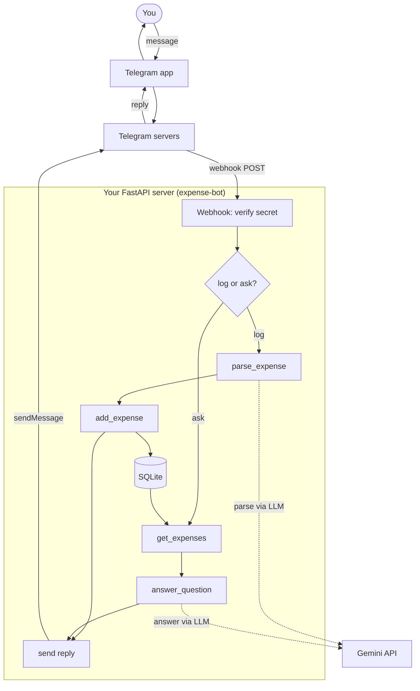

# Expense Bot

A personal Telegram bot for tracking expenses. You text it what you spent and it logs it; you ask about your spending and it answers.

## What it does

Send a message like "spent 40 on lunch" and the bot pulls out the amount and category, saves it, and replies with a short confirmation. Ask something like "how much have I spent this week?" and it reads your logged expenses and answers.

The bot distinguishes logging from asking: a logged expense gets a short acknowledgement, a question gets a full answer.

## How it works



Stack: Python, FastAPI (the webhook server), SQLite (storage), Google Gemini (parsing messages and answering questions). Incoming webhook requests are verified with a Telegram secret token.

## Running it locally

### Prerequisites
- Python 3.12+
- [Poetry](https://python-poetry.org/)
- A Telegram bot token (from [@BotFather](https://t.me/BotFather))
- A Google Gemini API key (from [Google AI Studio](https://aistudio.google.com))
- [ngrok](https://ngrok.com/) to expose the local server during development

### Setup
```bash
git clone https://github.com/DanielAsenso-G/expense-bot.git
cd expense-bot
poetry install
cp .env.example .env   # then fill in your secrets
```

`.env` needs:
```
TELEGRAM_BOT_TOKEN=...
TELEGRAM_WEBHOOK_SECRET=...
GEMINI_API_KEY=...
```

### Run
```bash
# 1. Start the server
poetry run uvicorn expense_bot.main:app --reload --app-dir src

# 2. In another terminal, expose it
ngrok http 8000

# 3. Register the webhook with Telegram (use your ngrok URL)
curl "https://api.telegram.org/bot<TOKEN>/setWebhook?url=https://<YOUR-NGROK-URL>/webhook&secret_token=<WEBHOOK_SECRET>"
```

Then message your bot on Telegram.

## Tech stack

Python · FastAPI · SQLite · Google Gemini · ngrok · Poetry