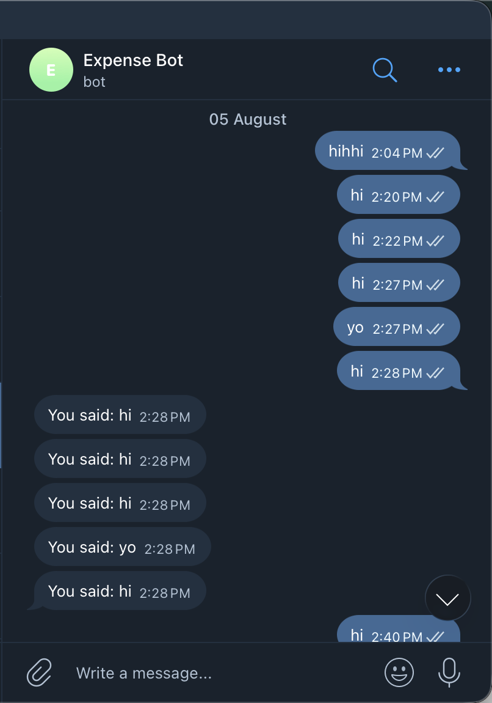
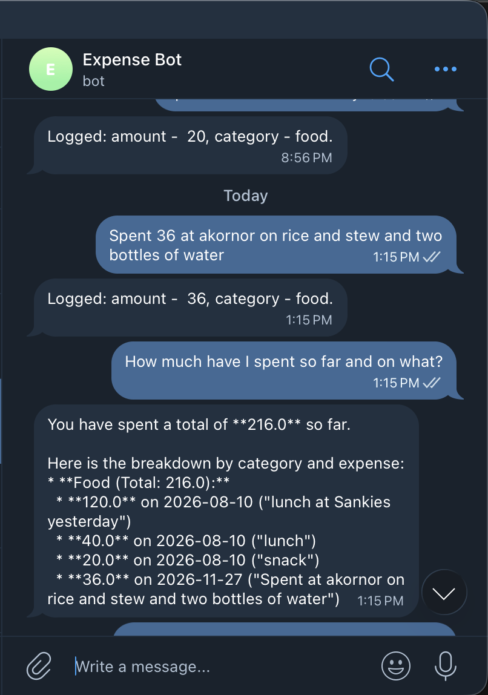

# How it was built

The project was built in deliberate phases, each ending in something that runs and can be checked — foundations (the "pipe") before features (the "water").

## Phase 0 — Plan & scope

Started from an enterprise WhatsApp integration design and deliberately cut it down to a minimal, personal spec — deciding each trade-off (one capability, SQLite over Postgres, the cheapest LLM, a single service) rather than inheriting them.

## Phase 1 — Bot + first message by hand

Created the bot and sent a message to myself by hand with `curl` — proving the external piece worked before writing any server code. (Originally targeted WhatsApp, but pivoted to Telegram after Meta's business-verification wall blocked a personal account. The architecture was channel-agnostic, so the switch was cheap.)

## Phase 2 — Repo + running server

Scaffolded the project (Poetry, git, a gitignored `.env`), wrote a minimal FastAPI server with a health route, ran it locally, and pushed it to GitHub.

## Phase 3 — Webhook: receive + verify

Exposed the local server with an ngrok tunnel, registered a webhook with Telegram, received real messages, and verified each request with a secret token — rejecting anything that isn't really from Telegram with a `403`.

## Phase 4 — Outbound reply

Closed the loop: the bot replies by calling Telegram's `sendMessage` API with `httpx`. The first version just echoed messages back, to prove the round trip worked.

<figure markdown="span">
  { width="380" }
  <figcaption>The first working loop — the bot echoing messages back.</figcaption>
</figure>

## Phase 5 — The brain

Added the real logic:

- a **SQLite** table for expenses,
- **Gemini** to parse free text into `{amount, category, note}`,
- storage (`add_expense`) and reads (`get_expenses`),
- a **router** that classifies each message as a *log* or an *ask*,
- and an answer path that reads the data and responds.

This is the functional MVP: the bot logs expenses and answers questions about them, end to end.

<figure markdown="span">
  { width="400" }
  <figcaption>The finished flow: logging expenses and answering a question from the stored data.</figcaption>
</figure>

## Phase 6 — Polish

README, this documentation site, the system-design diagram, screenshots, and deployment.

### Planned next

Give the LLM today's date / compute per-day totals in SQL (let the database do the math), handle non-text messages, add edit/delete, Excel export, and a hosted deployment.
