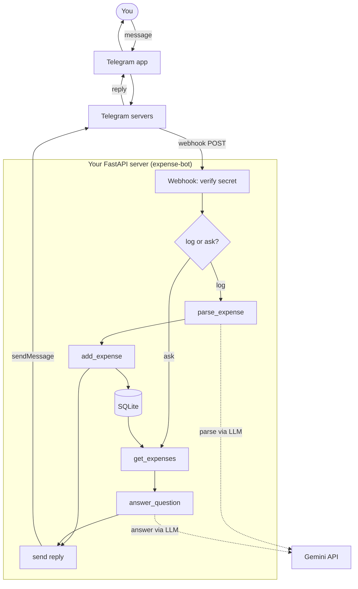

# How it works

Text the bot and it routes your message: one that records spending is *logged*, a question about spending is *answered*.

## The flow

1. You send a message in Telegram.
2. Telegram POSTs it to the bot's **webhook** (a FastAPI endpoint), which verifies a **secret token** to confirm the request really came from Telegram.
3. The bot **classifies** the message as a **log** or an **ask** (using Gemini).
4. **Log:** Gemini parses the message into `{amount, category, note}`, it's stored in SQLite, and the bot replies with a short confirmation.
5. **Ask:** the bot reads the stored expenses from SQLite, and Gemini answers the question using that data.
6. The reply goes back to Telegram via the Bot API.

## Stack

- **Python + FastAPI** — the webhook server (the receiving side).
- **SQLite** — stores the expenses.
- **Google Gemini** — parses messages, classifies intent, and answers questions.
- **ngrok** — exposes the local server to the internet during development.

Inbound webhook requests are verified with a Telegram secret token, so only Telegram can reach the bot.
