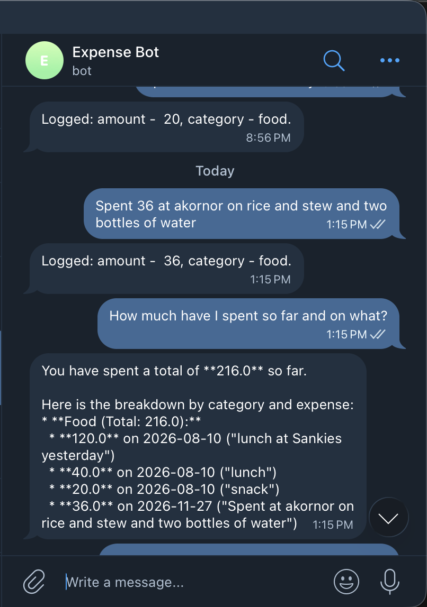

# Expense Bot

A personal Telegram bot for tracking expenses. You text it what you spent and it logs it; you ask about your spending and it answers.

This site documents how it was built and what I learned building it.

**Code:** [github.com/DanielAsenso-G/expense-bot](https://github.com/DanielAsenso-G/expense-bot)

## What it does

Send a message like "spent 40 on lunch" and the bot pulls out the amount and category, saves it, and replies with a short confirmation. Ask something like "how much have I spent this week?" and it reads your logged expenses and answers.

The bot distinguishes logging from asking: a logged expense gets a short acknowledgement, a question gets a full answer.

<figure markdown="span">
  { width="400" }
  <figcaption>Logging expenses, then asking for a breakdown.</figcaption>
</figure>

## Around this site

- **[How it works](how-it-works.md)** — the architecture and request flow.
- **[How it was built](build-log.md)** — the build, phase by phase.
- **[What I learned](learnings.md)** — the concepts and lessons, by theme.
